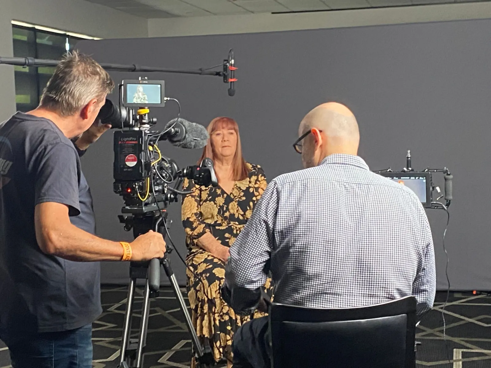
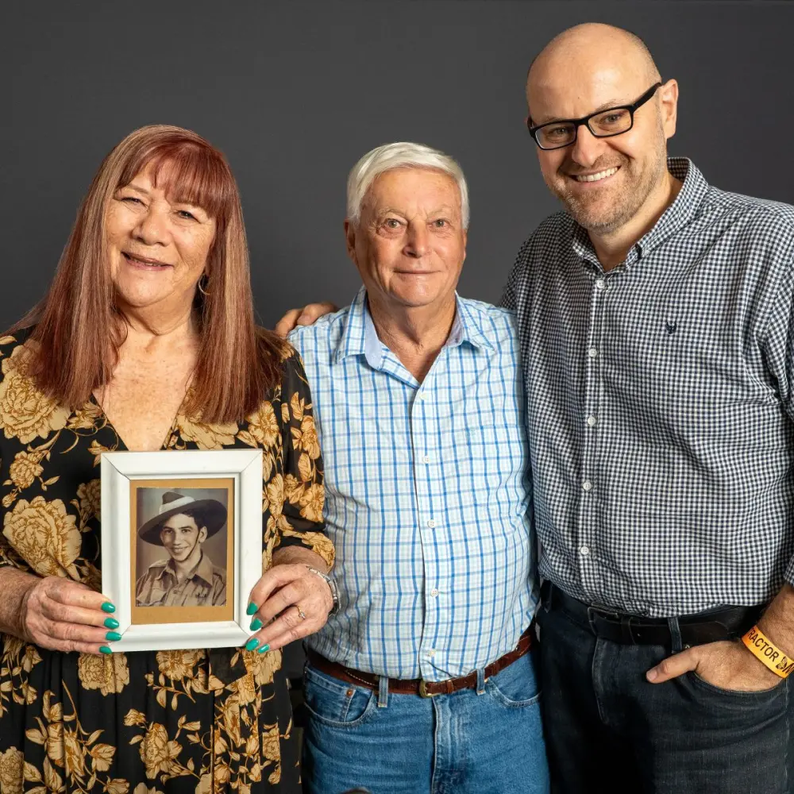
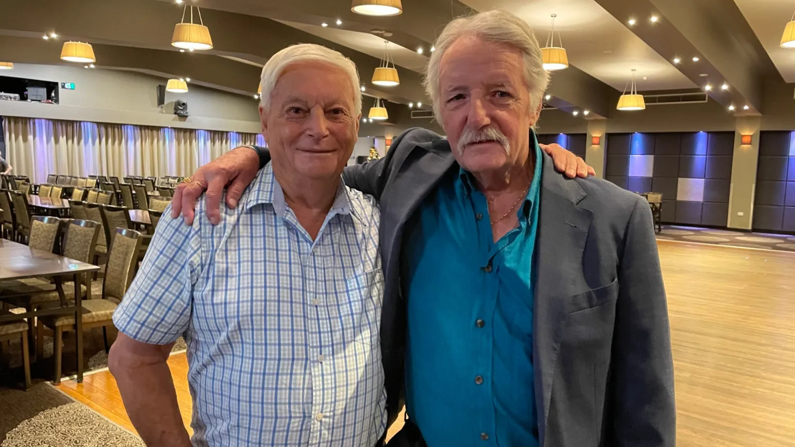

The upcoming feature documentary, DARWIN 1942: The Forgotten War That Reshaped Australia, will start filming at Merrylands RSL Club this week.

The documentary will tell the stories of the Aussies who fought for the Australian dream on Australian soil – and focus on the little-known Japanese bombing raids in Darwin during World War 2.

Merrylands RSL Club is a key supporter of the project, which will include an education study guide that will allow the documentary to be shown and taught in schools.

The filming will take place over the next two weeks in Merrylands, with veteran families from around Australia retelling and sharing the stories from the frontline of war that their parents told them.

*Wendy Hudson on the Veteran Stories set*
{:.release-caption}

One such family is Robert and Wendy Hudson, the son and daughter of Merrylands celebrated veteran, Wilbert "Darky" Hudson.

On the day of the first bombing raid on Darwin on February 19, 1942, Darky was taking a shower when the bombings began. Mid-shower, he sprang into action wearing only his army boots, helmet and a towel wrapped around his waist. In the heat of battle, the towel fell to the ground and, standing stark naked, he shot down a Japanese Zero fighter plane. This led to "Darky" Hudson being known as The Naked Gunner.

His son, Robert, explains how Darky took the gun off his mate's shoulder and waited until the plane was directly above him to get a clear shot, before firing and shooting the Japanese bomber to the ground.

Robert also tells of his father being one of only two men to receive a Military Medal for Bravery while serving on Australian soil, and the stories shared between his dad and his war mates.

*Robert and Wendy Hudson with Executive Producer and Director Richard Attieh*
{:.release-caption}

Robert and Wendy will be joined by 20 other veteran families who will also share their family stories, some of which include a future Governor-General of Australia Sir Zelman Cowen, and the future Prime Minister John Gorton.

> "This project is all about honouring veterans, commemorating their service and recognising current serving personnel," says Executive Producer and Director, Richard Attieh.
>
> "Merrylands RSL Club is leading the way in enabling this story to be told and shared with a brand-new generation of Australians."

In addition to supporting this documentary set for national release in early 2027, Merrylands RSL Club hold an annual Bombing of Darwin Commemorative Lunch on February 19.

> "The commemorative lunch earlier this year was the start to this project," explains Richard. "We produced a TV segment about the lunch for ANZAC Day 2026 and it was well received."
>
> "After the national interest in that TV segment, Merrylands RSL Club and the Hudson family agreed to be part of the documentary and education resources, and enabled this story to be shared with a wider audience."

The project is also supported by Cumberland City Council in honour of local veteran Wilbert "Darky" Hudson.

> "Wayne, the Merrylands RSL Club and Cumberland City Council are leading the conversation around making a bigger impact and raising more awareness of the WW2 bombings on Australian soil, which included over 100 raids along the northern coastline of Australia stretching from Broome to Townsville and continued until November 1943," said Richard.

*Sons of two veterans, Wilbert Hudson and Stanley Luck: Robert Hudson and Gary Luck met for the first time and shared stories about their fathers*
{:.release-caption}

The documentary will be released on February 19, 2027, to mark the 85th anniversary of the first and most devastating bombing raid on Australian soil.

- More information about DARWIN 1942: [darwin1942.com](https://darwin1942.com/)
- Photos of veteran families and additional photos are available on request.

### Media contacts

Richard Attieh 
Executive Producer and Director 
0407 708 466 
[richard@tvgroup.com.au](mailto:richard@tvgroup.com.au)

Merrylands RSL Club 
Mark McDonough 
Marketing and Events Manager 
02 8868 7725 
[markm@mrsl.com.au](mailto:markm@mrsl.com.au)
